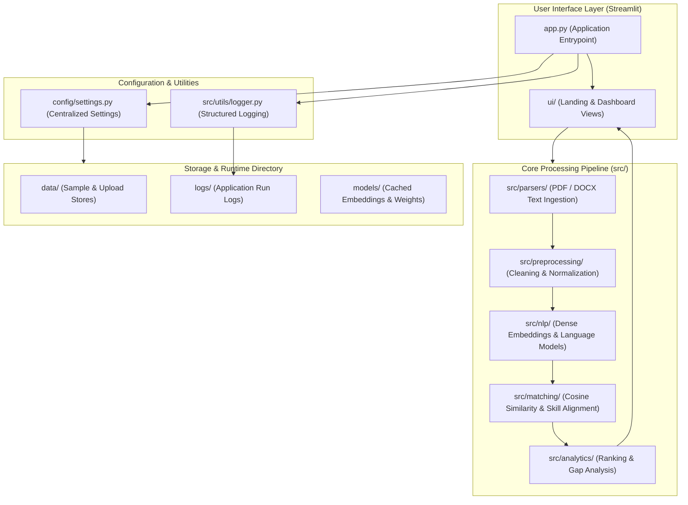
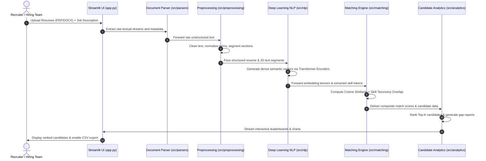
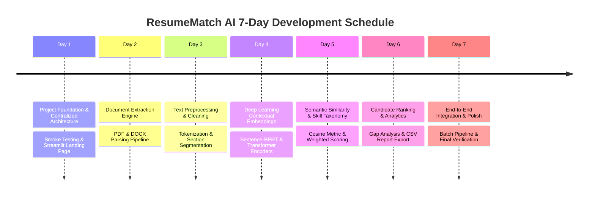

# ResumeMatch AI — System Architecture Specification

**Course:** CSE472: Deep Learning for Natural Language Processing 
**Milestone:** Day 1 — Project Foundation & Architecture 
**Repository:** [https://github.com/Anshdeepsingh-ai/ResumeMatch-AI](https://github.com/Anshdeepsingh-ai/ResumeMatch-AI) 
**Target Environment:** Python 3.12 (`nlp_env`)

---

## 1. Executive Overview

**ResumeMatch AI** is an intelligent candidate-to-job matching platform engineered for automated recruitment workflows. Traditional Applicant Tracking Systems (ATS) rely primarily on exact lexical keyword matching (e.g., TF-IDF or regex queries), causing high false-negative rates when candidates express equivalent technical competencies using varied syntax or phrasing.

ResumeMatch AI addresses this by framing resume screening as a **Deep Semantic Matching problem**:
1. Documents (PDF / DOCX resumes and job descriptions) are parsed and normalized.
2. Text sections are passed through deep contextual language representations (Transformer encoders / Sentence-BERT).
3. Dense vector embeddings are compared via metric learning and cosine similarity, supplemented by technical skill taxonomy alignment.
4. Candidate rankings, skill gap analyses, and interactive visual analytics are presented via a Streamlit interface with CSV export.

---

## 2. High-Level Architecture

The platform follows a clean, modular tiered architecture that decouples the user interface, centralized runtime configuration, data extraction, NLP modeling, matching logic, and analytics.

---

## 3. Modular Directory Breakdown

| Directory / File | Layer / Role | Description & Responsibility |
| :--- | :--- | :--- |
| `app.py` | UI Entrypoint | Initializes Streamlit application layout, logging, and landing views. |
| `config/settings.py` | Configuration | Centralized settings, path resolution, environment variables (`.env`). |
| `src/parsers/` | Ingestion | Multi-format extraction for resume and job description documents (PDF, DOCX, TXT). |
| `src/preprocessing/` | Data Cleaning | Text normalization, stopword filtering, section identification (Experience, Education, Skills). |
| `src/nlp/` | Deep Learning NLP | Transformer encoder models, dense semantic sentence/document embedding generation. |
| `src/matching/` | Matching Engine | Cosine vector similarity calculation, skill taxonomy intersection, and weighted hybrid scoring. |
| `src/analytics/` | Analytics & Reports | Top-K candidate sorting, skill gap breakdown, matching metric summaries, and CSV report export. |
| `src/utils/` | Utilities | Structured console and rotating file logger (`logger.py`). |
| `ui/` | Frontend Components | Modular Streamlit landing page, candidate ranking dashboards, and visualization components. |
| `tests/` | Quality Assurance | Pytest test suite covering smoke tests, configuration validation, and unit tests. |
| `docs/` | Documentation | Architecture specifications, design notes, and course reports. |
| `data/` | Data Store | Sample benchmark files (`data/sample/`), raw files, and extracted documents. |
| `logs/` | Runtime Logs | Rotating log files tracking application events and debug traces. |

---

## 4. End-to-End Data Pipeline

---

## 5. 7-Day Project Implementation Roadmap (CSE472)

### Detailed Milestone Description:
1. **Day 1 — Foundation & Infrastructure (Current Milestone):**
   - Repository scaffolding, Git policies (`.gitignore`), centralized environment settings.
   - Structured logging to console and `logs/app.log`.
   - Streamlit modular landing page detailing project motivation and planned features.
   - Pytest smoke test suite ensuring 100% import pass rate.
2. **Day 2 — Document Parsing (Completed):**
   - Multi-format text extraction (PyMuPDF / fitz, python-docx, and UTF-8 plain text).
   - Strict format validation, corruption handling, and configurable file size limits.
   - Non-PII metadata tracking (character count, word count, page count, paragraph count).
3. **Day 3 — Text Preprocessing & Cleaning:**
   - Case normalization, regex cleaning, email/phone scrubbing.
   - Section segmentation: isolating Skills, Experience, Education, and Certifications.
4. **Day 4 — Deep Learning NLP Embeddings:**
   - Loading pre-trained Transformer encoders (e.g. `all-MiniLM-L6-v2` or BERT).
   - Dense vector pooling strategies and embedding cache management.
5. **Day 5 — Semantic & Skill Matching:**
   - Cosine similarity computation between job embeddings and candidate embeddings.
   - Explicit skill extraction and match ratio weighting.
6. **Day 6 — Candidate Ranking & Analytics:**
   - Multi-candidate sorting, percentile scoring, and skill gap visualization.
   - Exporting ranking results and skill matrices to downloadable CSV.
7. **Day 7 — System Integration & Polish:**
   - End-to-end testing, error handling, batch upload evaluation, and course demonstration readiness.

---

## 6. Security, Privacy, and Git Policies

- **Candidate Privacy:** Real candidate resumes and personal identifiable information (PII) are strictly excluded from version control via `.gitignore` (`data/resumes/*`, `*.pdf`, `*.docx`).
- **Secrets & Configuration:** No API keys, credentials, or local environment configurations are committed (`.env`, `secrets.toml` are ignored, while `.env.example` provides non-sensitive templates).
- **Artifacts:** Pre-trained weights, checkpoints, embeddings, and log files are prevented from inflating repository size.
