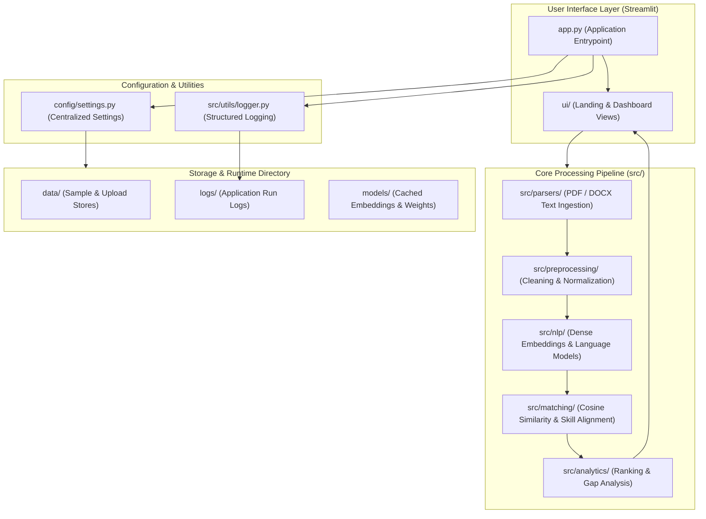
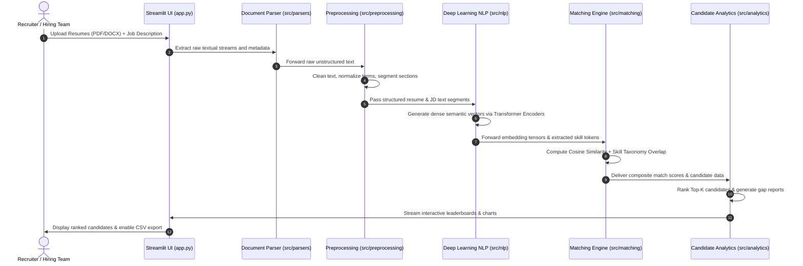
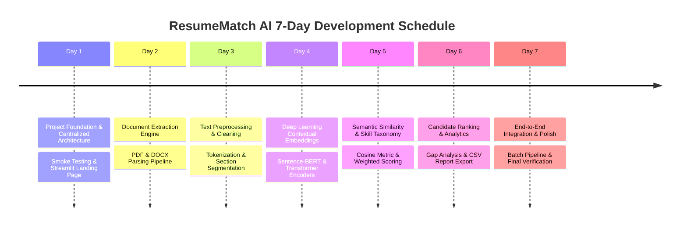

# ResumeMatch AI — System Architecture Specification

**Course:** CSE472: Deep Learning for Natural Language Processing 
**Milestone:** Day 1 — Project Foundation & Architecture 
**Repository:** [https://github.com/Anshdeepsingh-ai/ResumeMatch-AI](https://github.com/Anshdeepsingh-ai/ResumeMatch-AI) 
**Target Environment:** Python 3.12 (`nlp_env`)

---

## 1. Executive Overview

**ResumeMatch AI** is an intelligent candidate-to-job matching platform engineered for automated recruitment workflows. Traditional Applicant Tracking Systems (ATS) rely primarily on exact lexical keyword matching (e.g., TF-IDF or regex queries), causing high false-negative rates when candidates express equivalent technical competencies using varied syntax or phrasing.

ResumeMatch AI addresses this by framing resume screening as a **Deep Semantic Matching problem**:
1. Documents (PDF / DOCX resumes and job descriptions) are parsed and normalized.
2. Text sections are passed through deep contextual language representations (Transformer encoders / Sentence-BERT).
3. Dense vector embeddings are compared via metric learning and cosine similarity, supplemented by technical skill taxonomy alignment.
4. Candidate rankings, skill gap analyses, and interactive visual analytics are presented via a Streamlit interface with CSV export.

---

## 2. High-Level Architecture

The platform follows a clean, modular tiered architecture that decouples the user interface, centralized runtime configuration, data extraction, NLP modeling, matching logic, and analytics.

---

## 3. Modular Directory Breakdown

| Directory / File | Layer / Role | Description & Responsibility |
| :--- | :--- | :--- |
| `app.py` | UI Entrypoint | Initializes Streamlit application layout, logging, and landing views. |
| `config/settings.py` | Configuration | Centralized settings, path resolution, environment variables (`.env`). |
| `src/parsers/` | Ingestion | Multi-format extraction for resume and job description documents (PDF, DOCX, TXT). |
| `src/preprocessing/` | Data Cleaning | Text normalization, stopword filtering, section identification (Experience, Education, Skills). |
| `src/nlp/` | NLP Feature Extraction | Technical tokenization (C++, C#, .NET, Node.js), sentence segmentation, candidate keyword/phrase mining, and configurable skill extraction. |
| `src/matching/` | Matching Engine | Pluggable similarity engine (Sentence-BERT & pure-NumPy TF-IDF lexical fallback), cosine metric calculation, skill taxonomy alignment, and weighted hybrid scoring. |
| `src/analytics/` | Analytics & Reports | Top-K candidate sorting, skill gap breakdown, matching metric summaries, and CSV report export. |
| `src/utils/` | Utilities | Structured console and rotating file logger (`logger.py`). |
| `ui/` | Frontend Components | Modular Streamlit landing page, candidate ranking dashboards, and visualization components. |
| `tests/` | Quality Assurance | Pytest test suite covering smoke tests, configuration validation, and unit tests. |
| `docs/` | Documentation | Architecture specifications, design notes, and course reports. |
| `data/` | Data Store | Sample benchmark files (`data/sample/`), raw files, and extracted documents. |
| `logs/` | Runtime Logs | Rotating log files tracking application events and debug traces. |

---

## 4. End-to-End Data Pipeline

---

## 5. 7-Day Project Implementation Roadmap (CSE472)

### Detailed Milestone Description:
1. **Day 1 — Foundation & Infrastructure (Current Milestone):**
   - Repository scaffolding, Git policies (`.gitignore`), centralized environment settings.
   - Structured logging to console and `logs/app.log`.
   - Streamlit modular landing page detailing project motivation and planned features.
   - Pytest smoke test suite ensuring 100% import pass rate.
2. **Day 2 — Document Parsing (Completed):**
   - Multi-format text extraction (PyMuPDF / fitz, python-docx, and UTF-8 plain text).
   - Strict format validation, corruption handling, and configurable file size limits.
   - Non-PII metadata tracking (character count, word count, page count, paragraph count).
3. **Day 3 — Text Preprocessing & Normalization (Completed):**
   - Deterministic normalization pipeline (`src/preprocessing/`): Unicode NFKC, line endings, and control characters.
   - Cleaning extraction artifacts (end-of-line hyphen repair, bullet point standardization, divider removal).
   - Strict preservation of technical terms, programming languages, and punctuation (C++, C#, .NET, Node.js, version numbers).
   - Non-destructive processing: preserves case, avoids stopword removal or stemming to retain full semantic context.
4. **Day 4 — NLP Feature Extraction & Technical Profiling (Completed):**
   - Specialized technical tokenizer preserving C++, C#, .NET, Node.js, version numbers, and compound terms.
   - Robust sentence and bullet-point segmentation protecting abbreviations (Ph.D., Dr., e.g.).
   - Candidate keyword and keyphrase (2-gram, 3-gram) mining with stopword filtering.
   - Configurable skill taxonomy extractor (`src/nlp/skills.py`) distinguishing exact matches from alias matches.
   - Structured, serializable `NLPFeatures` payload containing comprehensive document statistics.
5. **Day 5 — Semantic & Skill Matching Engine (Completed):**
   - Pluggable similarity architecture (`BaseSimilarityEngine`): deep semantic embeddings via Sentence-BERT / Transformer models (`SentenceTransformerEngine`) and lightweight, pure-NumPy lexical vector space fallback (`TFIDFSimilarityEngine`).
   - Pure-NumPy TF-IDF vectorizer preserving technical expressions (C++, C#, .NET, Node.js, version numbers) with sublinear TF scaling and smooth IDF.
   - Cosine vector similarity calculation with dimension validation, numerical clipping, and 0.0–100.0 percentage mapping.
   - Automated skill taxonomy alignment integrating `src.nlp` feature extraction: determines matched skills, missing skills, and skill coverage ratio.
   - Documented composite scoring formula combining semantic similarity and skill coverage:
     $$\text{overall\_score} = (\text{semantic\_weight} \times \text{similarity\_score}) + (\text{skill\_weight} \times \text{skill\_coverage\_score})$$
     (default weights: 0.6 semantic, 0.4 skill; configurable via environment).
   - Evidence-based, non-judgmental explanation generation ensuring objective assessment without biased or exclusionary assertions.
   - Complete type hints, structured `MatchResult` schema, and offline-executable test suite.

### 5.1 Score Interpretation & Ethical AI Disclaimers

The matching engine generates two distinct primary scores and one composite heuristic:

1. **Semantic Similarity Score (`similarity_score`):**
   - **Scale:** Continuous value on a 0.0–100.0 display scale, mapped via $\max(0.0, \min(100.0, \text{cosine\_similarity} \times 100.0))$.
   - **Nature:** A scaled vector similarity metric. **It is NOT a probability, statistical confidence score, or calibrated percentage of candidate job suitability.**
   - **Model Distinctions:**
     - **Sentence-Transformers (Deep Neural Embeddings):** Measures contextual and conceptual affinity between documents in dense embedding space (e.g., connecting synonymous technical phrasing).
     - **TF-IDF Lexical Fallback:** Measures normalized term frequency-inverse document frequency overlap in sparse vector space. Reflects shared vocabulary rather than semantic comprehension.

2. **Skill Coverage Score (`skill_coverage_score`):**
   - **Scale:** Percentage on a 0.0–100.0 scale, calculated as $\frac{|\text{Matched Skills}|}{|\text{Target JD Skills}|} \times 100.0$ (or 100.0 if the job description specifies no canonical taxonomy skills).
   - **Nature:** An exact/alias vocabulary match ratio across predefined domain categories.

3. **Composite Overall Score (`overall_score`):**
   - **Formula:**
     $$\text{overall\_score} = (\text{semantic\_weight} \times \text{similarity\_score}) + (\text{skill\_weight} \times \text{skill\_coverage\_score})$$
     (Default weights: $\text{semantic\_weight} = 0.6$, $\text{skill\_weight} = 0.4$, configurable via `settings.py` / `.env`).
   - **Heuristic Characterization:** An exploratory ranking heuristic intended for recruiter triage. **It is NOT an automated employment decision tool, legal hiring recommendation, or psychometrically validated candidate grade.**
   - **Ethical Safeguards:** Explanations emphasize that absent keywords do not imply incompetence, as qualifications may be demonstrated under alternative nomenclature or within unlisted project achievements.

6. **Day 6 — Candidate Ranking & Analytics:**
   - Multi-candidate sorting, percentile scoring, and skill gap visualization.
   - Exporting ranking results and skill matrices to downloadable CSV.
7. **Day 7 — System Integration & Polish:**
   - End-to-end testing, error handling, batch upload evaluation, and course demonstration readiness.

---

## 6. Security, Privacy, and Git Policies

- **Candidate Privacy:** Real candidate resumes and personal identifiable information (PII) are strictly excluded from version control via `.gitignore` (`data/resumes/*`, `*.pdf`, `*.docx`).
- **Secrets & Configuration:** No API keys, credentials, or local environment configurations are committed (`.env`, `secrets.toml` are ignored, while `.env.example` provides non-sensitive templates).
- **Artifacts:** Pre-trained weights, checkpoints, embeddings, and log files are prevented from inflating repository size.
